# Ripple Architecture & FalkorDB Blueprint

Ripple is an autonomous on-call engineering crew powered by **FalkorDB** as its persistent operational graph brain.

---

## 1. High-Level System Architecture

```mermaid
flowchart TD
    subgraph UI ["Frontend (Vite + React + TypeScript)"]
        AC[Alert Console]
        AT[Agent Timeline & SSE Stream]
        GC[Graph Canvas & Subgraph Visualizer]
        HB[Hypothesis Board]
        MP[Memory Panel]
        CP[Counterfactual Panel]
        BT[Benchmark Tab]
        AB[Ask Brain Drawer]
        ID[Inspector Drawer]
    end

    subgraph API ["FastAPI Backend (Port 8000)"]
        TM[Tenant Middleware]
        ORC[Incident Orchestrator]
        TL[ToolLoop & LLM Abstraction]
        EXP[Explainability & Provenance Trace]
        MCP[FastMCP Server]
        WH[Alert Webhook Intake]
    end

    subgraph CREW ["4-Agent Crew (Blackboard Model)"]
        TR[Triage Agent]
        INV[Investigator Agent]
        RSP[Responder Agent]
        VRF[Verifier Agent]
    end

    subgraph TOOLS ["M4 Graph Tool Library"]
        BR[blast_radius]
        US[upstream_suspects]
        CR[criticality_ranking]
        RC[recent_changes]
        SH[service_health]
        PB[path_between]
        WK[who_knows]
        SI[similar_incidents]
        RR[rank_runbooks]
        CA[check_applicability]
        CB[counterfactual_blast]
    end

    subgraph FALKORDB ["FalkorDB Instance (Port 6379 / 3000)"]
        subgraph TENANT_STOREFRONT ["tenant_storefront"]
            S1[Services & Dependencies]
            I1[Incidents & Hypotheses]
            B1[Blackboard Tasks & Runs]
            M1[Episodic & Procedural Memory]
            V1[Vector Indexes: Incident, Decision]
        end
        subgraph TENANT_PAYMENTS ["tenant_payments"]
            S2[Isolated Tenant Graph]
        end
    end

    UI <--> |REST + SSE| API
    WH --> |JSON / Alertmanager| ORC
    ORC --> CREW
    CREW <--> TL
    TL --> TOOLS
    TOOLS --> |Cypher Queries| FALKORDB
    MCP --> |stdio / SSE| TOOLS
    EXP -.-> |Provenance Steps| ID
```



---

## 2. FalkorDB Graph Schema & Node Classes

### Operational Topology
- `(:Service {name, tier, repo, language})`
- `(:Service)-[:DEPENDS_ON {protocol, latency_p99, valid_from, valid_to}]->(:Service)`
- `(:Deployment {id, service, commit, env, ts, status})`
- `(:MetricSnapshot {service, error_rate, latency_ms, cpu_pct, ts})`
- `(:Person {login, name, role})`
- `(:Person)-[:OWNS]->(:Service)`
- `(:Person)-[:COMMITTED]->(:Deployment)`

### Blackboard Coordination
- `(:Incident {id, title, status, severity, opened_ts, resolved_ts, signature_embedding})`
- `(:AgentRun {id, agent_name, role, incident_id, status, started_ts, completed_ts})`
- `(:Task {id, incident_id, kind, status, payload})`
- `(:Observation {id, incident_id, service, text, kind, confidence_basis, ts})`
- `(:Conflict {id, incident_id, reason, involves, status, created_ts})`
- `(:Action {id, incident_id, kind, class, status, payload, undo_notes})`

### Memory & Learning
- `(:Hypothesis {id, incident_id, service, statement, score, margin})`
- `(:Hypothesis)-[:SUPPORTED_BY {weight, freshness}]->(:Evidence)`
- `(:Hypothesis)-[:CONTRADICTED_BY {weight, freshness}]->(:Evidence)`
- `(:Intervention {id, incident_id, runbook_id, predicted_outcome})`
- `(:Outcome {id, intervention_id, observed, duration_seconds})`
- `(:Runbook {id, title, success_count, fail_count, smoothed_rate})`
- `(:Decision {id, summary, status, ts, embedding})`
- `(:Decision)-[:SUPERSEDES]->(:Decision)`

---

## 3. Native FalkorDB Vector Indexing

Ripple leverages FalkorDB's built-in vector search:
```cypher
-- Index creation
CREATE VECTOR INDEX FOR (i:Incident) ON (i.signature_embedding) OPTIONS {dimension: 384, similarityFunction: 'cosine'};
CREATE VECTOR INDEX FOR (d:Decision) ON (d.embedding) OPTIONS {dimension: 384, similarityFunction: 'cosine'};

-- Native similarity search query
CALL db.idx.vector.queryNodes('Incident', 'signature_embedding', 5, vecf32([0.05, -0.12, ...]))
YIELD node, score
RETURN node, score;
```

---

## 4. Multi-Tenancy Architecture

Each tenant resides in a completely segregated graph namespace in FalkorDB:
- Tenant graphs: `tenant_storefront`, `tenant_payments`, `tenant_smoke`.
- No cross-tenant queries are possible; Cypher operations are executed exclusively against the tenant's dedicated connection context.
